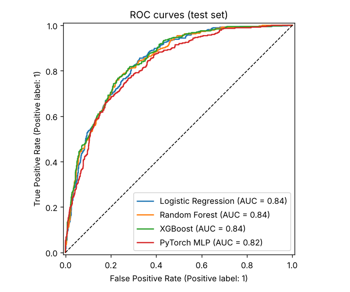

# 📉 Customer Churn Prediction

Predicts which telecom customers are likely to cancel their subscription, and explains **why** for each customer.
Compares Logistic Regression, Random Forest, **XGBoost** and a **PyTorch** neural network, handles class imbalance
with **SMOTE**, tunes with **GridSearchCV**, and ships as a **Streamlit** app in **Docker**.

Dataset: [IBM Telco Customer Churn](https://github.com/IBM/telco-customer-churn-on-icp4d) — 7,043 customers,
19 features, 26.5% churn rate.

## Results (held-out test set, 1,409 customers)

| Model | CV ROC-AUC | Test ROC-AUC | F1 | Precision | Recall | Accuracy |
|---|---|---|---|---|---|---|
| Logistic Regression | 0.845 | 0.839 | 0.613 | 0.510 | 0.770 | 0.742 |
| Random Forest | 0.845 | 0.841 | 0.632 | 0.541 | 0.759 | 0.765 |
| **XGBoost** ✅ | **0.846** | **0.844** | 0.625 | 0.562 | 0.703 | 0.776 |
| PyTorch MLP | 0.824 | 0.821 | 0.602 | 0.510 | 0.735 | 0.742 |

**Selected model: XGBoost** (best cross-validated ROC-AUC). With the decision threshold tuned for F1, the test set
scores **ROC-AUC 0.844 · F1 0.63 · recall 72%**, i.e. the model catches about 7 out of 10 customers who actually leave.

Top churn drivers (permutation importance): **contract type**, **tenure**, internet service type, tech support,
online security and payment method. Month-to-month customers churn at 42.7% vs. ~3% on two-year contracts.



## Features

- **EDA** (`churn/eda.py`): data-quality fixes, churn rate by segment, distributions and correlations
- **Feature engineering**: average monthly spend, bill-increase ratio, number of add-on services, tenure groups
- **Leak-free pipelines**: `imblearn` Pipeline = feature engineering → scaling + one-hot encoding → SMOTE → model.
  SMOTE only runs on training folds, never on validation/test data
- **Model comparison** with 5-fold stratified cross-validation and GridSearchCV
- **PyTorch neural network** wrapped as a scikit-learn estimator (BatchNorm, dropout, Adam, early stopping)
  so it goes through exactly the same pipeline and grid search as the other models
- **Threshold tuning** on out-of-fold training predictions to maximise F1 (instead of the default 0.5)
- **Per-customer explanations**: which inputs raise or lower *this* customer's churn risk
- **Streamlit app**: single-customer form, batch CSV scoring with download, and a model-performance dashboard
- **Docker** image and **pytest** tests

## Quick start

```bash
git clone https://github.com/shruti9934/customer-churn-prediction.git
cd customer-churn-prediction
python -m venv .venv && source .venv/bin/activate     # Windows: .venv\Scripts\activate
pip install -r requirements.txt

python -m churn.eda          # charts -> reports/figures
python -m churn.train        # trains + compares all models (~4 min), saves models/churn_model.joblib
streamlit run app.py         # http://localhost:8501
```

`python -m churn.train --fast` runs a tiny grid in ~30 seconds if you just want to check everything works.

### With Docker

```bash
docker build -t churn-app .
docker run -p 8501:8501 churn-app
```

### Tests

```bash
pytest -q
```

## Project structure

```
churn/
  config.py      paths, column lists, constants
  data.py        download + cleaning (blank TotalCharges, Yes/No -> 1/0)
  features.py    FeatureEngineer transformer + ColumnTransformer
  nn_model.py    PyTorch MLP + scikit-learn wrapper
  train.py       grid search, comparison, threshold tuning, saving artefacts and charts
  explain.py     per-customer explanations and risk bands
  eda.py         exploratory analysis and charts
app.py           Streamlit app
models/          trained model (churn_model.joblib)
reports/         metrics.json + figures/
tests/           pytest tests
```

## How it works (talking points)

- **Why ROC-AUC to pick the model, then F1 for the threshold?** ROC-AUC measures how well a model *ranks* churners
  above non-churners regardless of threshold, so it's a fair way to compare models. The business then needs a yes/no
  decision; on imbalanced data the 0.5 default is rarely best, so the threshold is tuned for F1 on out-of-fold
  predictions (never on the test set).
- **Why SMOTE inside the pipeline?** Oversampling before splitting leaks synthetic copies of validation rows into
  training and inflates scores. Inside an `imblearn` Pipeline, SMOTE runs only when fitting each training fold.
- **Why did XGBoost only slightly beat Logistic Regression?** The dataset is small and mostly categorical, and the
  strongest signals (contract, tenure) are close to linear. That's a useful finding in itself: a simple model is
  almost as good and easier to explain.
- **Why does the PyTorch MLP score lower?** Neural networks need more data to beat gradient-boosted trees on small
  tabular datasets. It's included as a comparison, trained with early stopping to avoid overfitting.
- **How are per-customer drivers computed?** For each input, the customer's value is swapped with values from 100 real
  customers and the average change in predicted probability is measured. A positive number means this customer's
  value raises their risk compared with a typical customer. It's model-agnostic, so it works for any model in the comparison.
